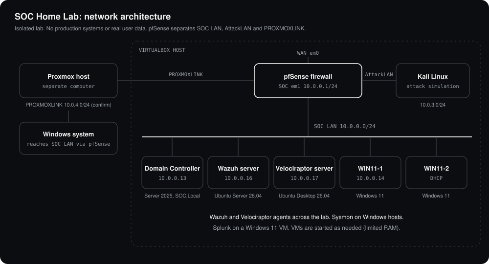

# SOC Home Lab

An isolated home lab for practising blue-team security operations: endpoint telemetry, detection, investigation and response. It contains no production systems and no real user data.

**Status:** the monitoring infrastructure is built and running. Mock attack scenarios are next, and each one will be written up in `scenarios/`.



## What is built

| Layer | Component | Role |
|---|---|---|
| Firewall and routing | pfSense | Routes and filters three internal networks: SOC, AttackLAN and PROXMOXLINK |
| Identity | Windows Server 2025 (evaluation), domain `SOC.Local` | Active Directory domain controller, 10.0.0.13 |
| Detection and monitoring | Wazuh 4.14 on Ubuntu Server 26.04 LTS | Central server collecting endpoint telemetry, 10.0.0.16 |
| Endpoint investigation | Velociraptor on Ubuntu Desktop 26.04 | Live endpoint queries and forensic collection, 10.0.0.17 |
| SIEM (additional) | Splunk on a Windows 11 VM | Second log platform alongside Wazuh |
| Endpoint telemetry | Sysmon on Windows hosts | Detailed process, network and registry events |
| Endpoints | Windows 11 Enterprise (evaluation) VMs, domain-joined | Monitored workstations |
| Second hypervisor | Proxmox on a separate computer, linked through pfSense | Hosts an additional Windows system |
| Attacker | Kali Linux on AttackLAN | Source of simulated adversary activity |

Wazuh and Velociraptor agents are deployed across the lab's Windows and Ubuntu systems. The screenshots below capture the VMs that were running at the time.

**Resource constraint:** the lab host has limited RAM, so not every VM runs at once. Systems are started as each exercise needs them, with pfSense, the domain controller, the Wazuh server and the Velociraptor server running as the core.

## Network and firewall design

- **VirtualBox** hosts pfSense, the domain controller, the Wazuh server, the Velociraptor host, the Windows 11 workstations and Kali. Windows 11 VMs sit on a VirtualBox internal network.
- **SOC LAN (10.0.0.0/24)** runs on VirtualBox internal network LAN0 and holds the monitored systems.
  - 10.0.0.1: pfSense gateway.
  - 10.0.0.2 to 10.0.0.20: static infrastructure (DC .13, WIN11-1 .14, Wazuh .16, Velociraptor .17).
  - 10.0.0.21 to 10.0.0.254: DHCP pool.
- **AttackLAN (10.0.3.0/24)** is a separate pfSense interface (`em2`, gateway 10.0.3.1) on VirtualBox internal network LAN1, for Kali, so simulated attacks cross the firewall and leave real network evidence.
- **PROXMOXLINK** is a separate pfSense interface that connects the Proxmox host to the SOC LAN.

Firewall policy, taken from the live rule sets:

| Interface | Policy |
|---|---|
| SOC | Allow to SOC, allow to AttackLAN, allow to non-private (internet) addresses, then a final block-all rule |
| AttackLAN | Allow to SOC subnets (so Kali can reach monitored systems), allow to non-private addresses |
| PROXMOXLINK | Allow to SOC subnets, plus a general allow rule |

## Design decisions

- **Ubuntu Server 26.04 LTS** for Linux roles instead of the 22.04 named in many older install guides. A current LTS has the longest support window. Vendor install scripts often assume older Ubuntu paths, so each is checked against current documentation. cgroup v1 support is removed in 26.04, which matters for containerised components.
- **Reserved static range** for infrastructure so detection content and documentation point at stable addresses.
- **Two telemetry paths** (Wazuh for detection, Velociraptor for investigation) so an alert can be followed straight into a live endpoint query.
- **Run only what each exercise needs.** Limited RAM means a core set of VMs stays up and endpoints and Kali are started on demand.
- **Separate attacker network** so attack traffic is routed and logged by the firewall.

## Evidence

| | |
|---|---|
| Wazuh agents | [docs/screenshots/wazuh-agents.png](docs/screenshots/wazuh-agents.png) |
| Velociraptor clients | [docs/screenshots/velociraptor-clients.png](docs/screenshots/velociraptor-clients.png) |
| Active Directory (`SOC.Local`) | [docs/screenshots/active-directory-users.png](docs/screenshots/active-directory-users.png) |
| pfSense rules: SOC | [docs/screenshots/pfsense-rules-soc.png](docs/screenshots/pfsense-rules-soc.png) |
| pfSense rules: AttackLAN | [docs/screenshots/pfsense-rules-attacklan.png](docs/screenshots/pfsense-rules-attacklan.png) |
| pfSense rules: PROXMOXLINK | [docs/screenshots/pfsense-rules-proxmoxlink.png](docs/screenshots/pfsense-rules-proxmoxlink.png) |
| VirtualBox VM list | [docs/screenshots/virtualbox-vm-list.png](docs/screenshots/virtualbox-vm-list.png) |

## Next: mock scenarios

*Each completed scenario gets a write-up in `scenarios/`: what was simulated, which telemetry appeared, which rule fired, what the investigation concluded and what was tuned afterwards. None are listed because none have been run yet.*

## Repository layout

```
soc-home-lab/
├── README.md
├── docs/
│   ├── architecture.svg
│   └── screenshots/
└── scenarios/
```
